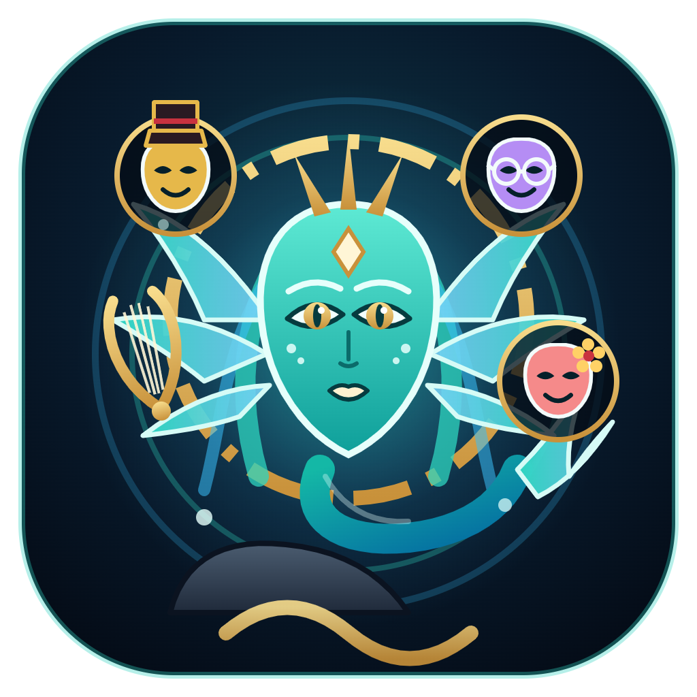

<div align="center">



# Siren Assistant

**A personal AI assistant for your desktop and your phone: she talks, listens, remembers, teaches, coaches, and improves herself.**

Voice-first · Claude-powered · Obsidian memory · Windows & macOS · Android app · Runs on your own machine


[Features](#features) · [Install](#quick-start) · [System requirements](#system-requirements) · [Quick start](#quick-start) · [On your phone](#on-your-phone) · [Talking to it](#talking-to-it) · [Safety](#safety-and-permissions) · [Privacy](PRIVACY.md) · [Security](SECURITY.md) · [Changelog](CHANGELOG.md) · [Troubleshooting](TROUBLESHOOTING.md) · [Architecture](CLAUDE.md)

</div>

---

Siren is an assistant you talk to like a trusted colleague: a chief of staff, a tutor and a good friend in one. Hold a key (or just speak, hands-free), and she answers in a natural voice within a few seconds, with your schedule, your notes, your documents and your GitHub repos at hand. She keeps her memory in an Obsidian vault you can read and edit, asks before she does anything consequential, and can change her own code when you ask for a feature, with every change checked, tested, recorded and reversible. Away from your desk, the Android app (or any phone browser) has the same assistant, your day, your habits, what you're learning and your notes, while the brain, the memory and the keys stay on your computer.

> **Formerly Nexus Agent.** Updating keeps everything: your data folder moves to its new name by itself, and your assistant's name, look, face, voice and brain stay as they were. Siren, the new default persona, is one click away in Settings → Persona.

> Inspired by [jaredrhod/fullstack-agent](https://github.com/jaredrhod/fullstack-agent): a warm Claude session, memory loaded on demand, standing rules, an agent that is its own mechanic, and hardened voice handling.

## Features

### 🎙️ Voice that feels like a conversation
- **Push-to-talk or hands-free.** Hands-free uses a **neural voice detector** (Silero VAD), so breathing, coughs and keyboard noise don't trigger it, and a quick "yes" still counts.
- **Fast, accurate local speech-to-text.** Whisper large-v3 turbo runs **on your GPU** (WebGPU), about 0.4 s for a sentence on a laptop RTX GPU, with an automatic CPU fallback.
- **A natural voice from the first sentence:** an offline neural voice ([Kokoro](https://huggingface.co/hexgrad/Kokoro-82M)) runs right in the app (free, private, no internet once downloaded), spoken sentence by sentence as the reply streams in. For even more natural and cloneable voices, use [VoiceStudio](https://github.com/debpalash/VoiceStudio).
- **One app to open:** Siren starts its helper apps (VoiceStudio, and FreeLLMAPI if you use it) in the background, minimized, and starts them again when they're needed. Optionally it closes them when you quit (Settings → Helper apps).
- **Make new voices by asking:** "make me a warm, low British voice", or clone your own by reading a short script.
- **Voice calibration** learns how your names and words get misheard and fixes them from then on.
- **Interruptible:** talk over it (with headphones) or press the key.
- A subtle **grandfather-clock tick** while it works on longer tasks (or soft, classic, or off).

### 🧠 A brain with memory
- **Your Claude account** through the Claude Code CLI, kept as a warm session. Spoken turns use the fast model, typed ones your default, switched **without restarting** the session. Also works with an Anthropic API key or any OpenAI-compatible server (e.g. FreeLLMAPI, Ollama, LM Studio).
- **Multi-provider mode with automatic fallback:** Claude, Gemini, DeepSeek, Groq, Perplexity and FreeLLMAPI in **your** priority order (drag to rank them). When one hits a rate limit, a usage cap or runs out of credits, the next one answers and the limited one rests for a while. Optional **smart routing** picks the best one per task: code → Claude/DeepSeek, web questions → Perplexity, quick spoken replies → Groq, very long inputs → Gemini.
- **Agent Skills:** save a workflow once ("morning briefing", "clean up my meeting notes") and run it with `/name`, a trigger phrase, or one click. Or just say "make that a skill".
- **Memory in an Obsidian vault:** a living profile, active priorities, daily notes, reusable procedures ("Jobs") and atomic memories. Every note is versioned and restorable.
- **Picks up where you left off:** when you close the app, it writes itself a short note about what you were doing, what's open and what's next. Next time it knows, the empty chat offers **Continue**, and the greeting mentions it.
- **Standing rules** in every prompt: verify before claiming, treat external content as data, never expand its own access.

### 🧰 Works with your stuff
| | |
| --- | --- |
| 📄 **Documents** | Opens PDFs, Word files, Markdown, images… each in **its own window** with zoom, fit-to-width and page navigation. Finds files by name in your **workspace folder** first ("open the quarterly report PDF"). |
| 🖥️ **Monitors** | Named by where they are: "move the quarterly report to the **right** monitor", "make it full screen", "which monitor is which?" |
| 👀 **Screen sharing** | Share a screen or window and it **sees what you see**: "what's wrong with this error?", "help me fill in this form". You pick what to share; nothing is recorded. |
| 📝 **Notes & PDFs** | Quick notes (Ctrl+Shift+N), "save this reply as a note", and **PDF export** of any reply, note or whole chat. Ask it to "write that up as a PDF". |
| 📅 **Calendar** | Nothing to connect: **tell it your schedule** ("I have Linear Algebra every Monday at 10 in H1 until February") and it keeps it in `Schedule.md` in its vault, repeat rules included. A themed month / week / agenda view to look at and edit it, also on the phone. |
| 🐙 **GitHub** | Reads repos, issues and pull requests; clones a repo, works on a branch and commits. **Push and PRs always ask.** It never merges. |
| 🌐 **Web** | Searches and reads pages, citing sources. |

### 🎓 Learning, coaching and routines
- **Understanding over memorizing:** intuition first, then the rigorous version; proofs with the strategy, every step justified and hints instead of answers while you work (`/explain`, `/proof-coach`, `/teach-back`, `/study-session`). **Formulas render** (LaTeX) and are **read aloud in words**.
- **A learning tracker** per topic in your vault: what you understood, what's shaky, misconceptions and open questions; the assistant follows up next time.
- **For polyglots:** vocabulary decks with **spaced repetition**, reviews by voice (`/drill`), and **speaking practice** (`/converse`): speech recognition and the voice switch to the language you practice.
- **A life-coach side and a habit tracker:** goals into small steps, tiny anchored habits with streaks (Habits view, or just say "I went for a run"), `/goal`, `/reflect`, `/weekly-review`.
- **A skill tree** of everything you're growing, as a constellation: progress comes from your learning tracker, decks and habits; skills unlock as their foundations grow.
- **Routines:** the assistant works on a schedule while the app is open: a daily briefing, syncing Google Calendar or Todoist, summarizing new Plaud recordings, a daily language text. Each run notifies you.
- **Claude connectors and plugins** (with the Claude account brain): the services on your claude.ai account, each set to ask, allow reading, allow all but deleting, or allow everything.
- **Skills from GitHub:** import Agent Skills (SKILL.md folders, e.g. mattpocock/skills) with their reference files; nothing in them is run.
- **Diagrams:** clean HTML + SVG diagrams saved in your vault (45 types with the diagram-design skill).
- **Extensions** (Claude account brain): **REA** to reverse engineer how apps, websites and binaries work, with evidence; **God's Eye View**, a live 3D globe of public world data (flights, ships, satellites, weather, quakes) the assistant can query and show you.
- **Persona templates:** Ada (STEM tutor), Mira (polyglot coach), Sol (life coach), each with its own look, face and voice. Ask **"How can I use you?"** for a tour of everything, tailored to you.

### 📱 On your phone
- **Chat with the same assistant** from any phone browser or the **Android app**: replies stream live, conversations are shared with the desktop, and spoken replies play on the phone.
- **Your day on the phone:** tabs for **Today** (schedule, habits, priorities, cards due, where you left off), **Habits** (check them off; the desktop sees it at once), **Learn** (topics and decks), and under More your memories, notes, skill tree, the **Inner World** village and your skills.
- **Approve from anywhere:** approval cards (with a countdown) on the phone, and on Android as **notifications with Allow / Deny**, even with the app closed.
- **Push-to-talk on the phone,** transcribed on your computer with your own speech-to-text. On Android also a **Quick Settings tile** and **Share → Siren** from any app.
- **Pair by QR code** in seconds; reach it at home over Wi-Fi or **from anywhere** through Tailscale (set up with one click on the desktop) or your own Cloudflare Tunnel (optionally behind Cloudflare Access). No port is opened on your router and no server of ours is involved.
- **The same face** as the desktop, with the same states and colours.

### 🛠️ Its own mechanic, and its own engineer
- **Self-improvement:** ask for a feature; it states a plan you approve (with the design, the risks and how it will verify it), edits its own code, checks it, **runs its tests** and commits it. The **Evolution** view shows every change with its diff, one click to revert.
- **Engineering discipline built in:** coding and debugging requests get more room to work (up to 40 tool steps, more thinking), an engineering playbook ([`docs/ENGINEERING.md`](docs/ENGINEERING.md)), exact code search, an architecture map, and a review of its own diff before it records anything.
- **Changes are verified, not just saved:** every change must pass a syntax check, **cross-file integrity checks** (IPC channels, imports, settings) and the **automated test suite**. After it goes live, the app checks its log; if the change caused problems, you're told, Evolution offers **Revert**, and the assistant knows so it can fix them.
- **Diagnostics:** health checks, `analyze_errors` (the log's problems grouped, with counts and the exact place in the code), and a log where every request is traceable end to end (`[turn=…]` tags, timings, error stacks, secrets masked).
- **One-click bug reports** with everything needed to find a problem, and no secrets.
- **Crash-resistant:** recovers from a damaged settings file, a crashed window, a lost microphone, a hung speech model or a Claude session that fails to start.

### 🎨 Yours to shape
- **Persona studio:** a master prompt, an image and an aesthetic; one click redesigns colours, fonts, face, greeting, tone and voice.
- **Animated faces:** **Siren** (the default: a sea-nymph whose fins spread as she listens, a lyre halo that turns as she thinks, song rings that ripple with her voice), Circuit Board, Radial, Code Rain, Neural Core, the expressive **Companion**, or your own: the note **Make Your Own Face** in your vault has a prompt to design one with any AI app. Faces show listening, thinking, **working** (running tools), speaking, **happy** (done) and **sleeping** (idle).
- **A futuristic HUD look** (Settings → Interface → Visual effects): a perspective grid on the horizon, corner brackets, telemetry on every reply, an energy border while it thinks, and a short systems check at launch. **Subtle** keeps the look without motion; **Off** is the plain look. It follows any persona theme, light ones too, and stays still if your system asks for reduced motion.
- **Layouts:** chat only, chat and face **side by side** (drag the divider), or the **face full size** with the chat underneath; app-wide **zoom**; full screen.

## System requirements

| | Minimum | Recommended |
| --- | --- | --- |
| **OS** | Windows 10 (64-bit), macOS 12, or a recent 64-bit Linux | Windows 11, macOS 14+ |
| **CPU** | 4 cores / 4 threads, x64 or Apple Silicon | 8+ cores |
| **RAM** | 8 GB | 16 GB (32 GB+ to also run a local model) |
| **GPU / VRAM** | Not required (speech recognition falls back to the CPU) | A WebGPU-capable GPU with **4 GB+ VRAM** for fast local speech recognition (Whisper large-v3 turbo) |
| **Disk** | 2 GB free (app + speech models) | 5 GB+ (more if you keep several speech models) |
| **Network** | Internet for cloud brains, web search and model downloads | Broadband; all voice processing can stay local |
| **Audio** | A microphone for voice input | A headset for hands-free mode |

**Running a local brain** (Ollama, LM Studio or another OpenAI-compatible server, used through FreeLLMAPI / multi-provider mode) needs much more:

| Local model size | GPU memory (VRAM) | Experience |
| --- | --- | --- |
| 7–8B parameters | 6–8 GB | Usable for simple chat; weak at tool use |
| 12–14B | 10–16 GB | Good for quick private tasks |
| 27–32B | 20–24 GB | Close to cloud quality for everyday tasks |
| 70B+ | 40 GB+ or a multi-GPU / unified-memory machine | Best local quality |

Not sure? The setup wizard has an optional **hardware check** that looks at your processor, memory and graphics card and recommends the speech model and whether a local or a cloud brain fits (also in **Settings → Health → Scan hardware**).

## Quick start

Everything is on the [**Releases**](https://github.com/Andreas-Erick/fullstack-agent/releases/latest) page.

### Windows

Download **`Siren-Assistant-Setup-x.y.z.exe`** (or the `.msi`, or the portable `.exe`) and run it. It installs for your user account (no admin rights needed), puts **Siren Assistant** on the desktop and in the Start menu, and starts it when it finishes. The installer isn't code-signed yet, so Windows SmartScreen may ask you to confirm (**More info → Run anyway**). Updating from Nexus Agent: just install over it.

### macOS

Download **`Siren-Assistant-x.y.z-mac-arm64.dmg`** (Apple silicon: M1 and later) or **`…-mac-x64.dmg`** (Intel), open it and drag **Siren Assistant** to Applications. The app isn't notarized by Apple yet, so the first time **right-click it → Open** (or System Settings → Privacy & Security → **Open Anyway**). macOS then asks once for the microphone (voice input) and, if you share your screen, for Screen Recording. Command-line tools such as `claude`, `gh` or `tailscale` from Homebrew are found even when the app is started from the Dock.

### Android

Download **`Siren-Android-x.y.z.apk`** on the phone and install it (Android 8 or newer; allow installing from your browser once). See [On your phone](#on-your-phone).

### From source

**Requirements**
- [Node.js](https://nodejs.org) 22 or newer
- A brain: **[Claude Code](https://claude.com/claude-code)** signed in to your Claude account (recommended), an Anthropic API key, a Gemini / DeepSeek / Groq / Perplexity key, or an OpenAI-compatible server (any combination in multi-provider mode)
- Optional: [VoiceStudio](https://github.com/debpalash/VoiceStudio) for even more natural, cloneable voices (installed, it is started by Siren; you don't open it yourself), the [GitHub CLI](https://cli.github.com) (`gh auth login`) for GitHub, a GPU with WebGPU for the fastest speech recognition

```bash
git clone https://github.com/Andreas-Erick/fullstack-agent.git
cd fullstack-agent
npm install
npm start            # or start.bat (Windows) / ./start.sh
npm run dev          # dev mode: DevTools open, menu bar kept (or dev.bat / ./start.sh dev)
```

If npm skipped Electron's binary download, run `npx install-electron` once.

### First launch: a guided setup

A short setup walks you through everything, one topic at a time:

1. **Meet Siren** and choose her name.
2. **Privacy and safety:** a short version of the [privacy policy and disclaimers](PRIVACY.md) to read and accept, and how careful she should be (ask first, or just do it).
3. **Your computer** (optional): a hardware check that recommends the speech model and the kind of brain that fits.
4. **The brain:** your Claude account (recommended), several providers with automatic fallback, a local server, or an API key, with a test.
5. **Voice:** the offline voice (downloaded once, with a sample) or VoiceStudio; your microphone; push-to-talk or hands-free.
6. **Memory:** her own vault, or an existing Obsidian vault.
7. **What you want help with:** studying, languages, goals and habits, work. It adds the matching personas and a daily briefing.
8. **Connectors and extras:** what is built in, which Claude connectors fit your goals (none come with the app; [why](docs/CONNECTORS.md)), the extensions and the phone app.
9. **Personality and face.**
10. **What I can do:** a tour of every feature, with things to say.
11. **First hello:** voice, brain, vault and microphone tested end to end. Then she offers to **get to know you** in a short conversation and keeps what she learns in your profile.

Both setup styles (this form, or setting up by conversation) can be re-run from **Settings → Health**.

## On your phone

Remote access is **off by default**. While it is on, a **Remote** badge shows in the title bar; one click turns everything off.

1. **Turn it on:** Settings → Remote access. Choose how the phone reaches your computer:
   - **This computer's network** (home Wi-Fi): simplest, but the connection is not encrypted, so use it only on a network you trust.
   - **From anywhere, encrypted (recommended):** **Tailscale** (only your own devices, end-to-end encrypted): install it on the computer and the phone with the same account, and a checklist in Settings checks every step on this computer and fixes what is missing (**Set up Serve for me**; enabling HTTPS for your tailnet once). The full walkthrough, with a troubleshooting table: [docs/TAILSCALE.md](docs/TAILSCALE.md). Or your own **Cloudflare Tunnel**, ideally with a **Cloudflare Access** sign-in in front (the app verifies it). A temporary Cloudflare address is there for testing. No router port is opened either way.
   - **Already paired over Wi-Fi?** Open the phone app at home and tap **Switch** in the banner (or in the menu): it moves to the secure address and keeps its pairing.
2. **Pair:** click **Pair a device** and **scan the QR code** with the phone's camera; the phone app opens already connected. Or open the address on the phone and type the six-digit code. Codes and QR links work once and expire after five minutes.
3. **Android (optional):** install `Siren-Android-x.y.z.apk` (or the `-debug.apk`) from [Releases](https://github.com/Andreas-Erick/fullstack-agent/releases/latest) (Android 8 or newer), enter the address or paste the QR link, and turn on notifications to get approvals and replies while the app is closed. Build it yourself: [`android/README.md`](android/README.md).

A paired phone can chat, read conversations, answer approvals sent to it, and (unless you turn it off: Settings → Remote access → "Show my notes, memories…") see your day, habits, learning, memories, notes, skill tree and Inner World, read-only except for checking habits off. It never sees your settings, keys, the setup conversation or screenshots of your desktop, and tool activity reaches it as names only (never what a tool read or wrote). Each device is listed in Settings with where it last connected from; remove one, or all at once. A device unused for 90 days is unpaired automatically. Push-to-talk on the phone needs the encrypted address (browsers allow the microphone only there).

## Talking to it

- **Push-to-talk:** hold **F8** (configurable) or the mic button. **Ctrl/Cmd+Alt+Space** toggles listening from anywhere.
- **Hands-free:** say "go hands free". Wear headphones (and tick "I use headphones") to talk over it.

**Things to try**

> "What's on my schedule on Monday?" · "I have Physics lab every Tuesday 14–16 in B2 this semester." · "Move my dentist appointment to 4 pm." · "No lecture next Monday."
> "Open the project slides on the left monitor." · "Make it full screen." · "Close the PDF."
> "Look at the open issues in my website repo and fix the first one." *(it asks before pushing)*
> "Make me a calmer voice." · "Calibrate my voice." · "Create a bug report."
> *(sharing your screen)* "What does this error mean?" · "Turn our chat into a PDF." · "Save what you just did as a skill."
> "Add a button that exports today's chat to my vault." *(self-improvement, with your approval)*

<details>
<summary><b>Voice commands</b> (spoken on their own, handled instantly without the model)</summary>

| Say | Does |
| --- | --- |
| "go hands free" / "push to talk" | Switch the microphone mode |
| "switch to the fast model" / "deep model" / "default model" | Switch the model |
| "stop asking for permission" / "start asking again" | Switch the permission mode |
| "clear the session" | Start a new conversation |
| "close the document" / "close the PDF" | Close the latest document window |
| "make it full screen" / "exit full screen" / "minimize the document" / "maximize it" / "bring back the PDF" | Control the latest document window |
| "stop sharing" | Stop sharing your screen |
| "chat only" / "split view" / "show your face" | Switch the chat layout |
| "zoom in" / "zoom out" / "reset zoom" | Zoom the app |
| "stop" | Stop speaking |
| "mute" / "unmute" | Turn spoken replies off / on |

</details>

<details>
<summary><b>Keyboard shortcuts</b></summary>

| Keys | Action |
| --- | --- |
| Enter / Shift+Enter | Send / new line |
| F8 (hold) | Push-to-talk |
| Ctrl/Cmd+Alt+Space | Listen from anywhere |
| Ctrl/Cmd+1…8 | Chat, Face, Memory, Calendar, Vault, Documents, Evolution, Skills |
| Ctrl/Cmd+Shift+1 / 2 / 3 | Chat only / side by side / face layout |
| Ctrl/Cmd + / − / 0, Ctrl + wheel | Zoom in / out / reset (over a document: zoom the document) |
| Ctrl/Cmd+, | Settings |
| Ctrl/Cmd+N | New conversation |
| Ctrl/Cmd+Shift+N | Quick note |
| `/` in the message box | Run a skill (Tab completes) |
| F11 | Full screen (on Face: full-screen face) |
| Esc | Stop speaking / exit full screen / close a document window |

</details>

## Safety and permissions

Choose **Ask** (approve consequential actions) or **Auto**. Approve by clicking or by saying "yes" ("yeah", "okay", "go ahead"…); "details" reads the action aloud; anything else declines, and your words go back to the agent as the reason. No answer within 75 s counts as no.

| Action | Ask mode | Auto mode |
| --- | --- | --- |
| Changing its own code, its settings, deleting things | asks | allowed (but code changes after reading a web page or document always ask) |
| Removing an entry from your schedule, local commits | asks | allowed |
| Shell commands | **always asks** | **always asks** |
| Pushing to GitHub, opening a pull request | **always asks, each time** | **always asks, each time** |
| Cloning a voice from an audio file (recording yourself in the app is your consent) | **always asks, each time** | **always asks, each time** |
| Seeing your screen | only while **you** share it | only while **you** share it |
| Answering an approval from a paired phone | on the phone's approval card or Android notification (passwords, keys and voice recordings only on the computer) | same |

It can never change its own safety settings, permissions or code access, and it can't read secrets. Web pages, documents, issues and repository files are treated as data, never as instructions. Found a security problem? Please report it privately: [SECURITY.md](SECURITY.md).

## Self-improvement and recovery

Ask for a feature and it calls `self_change_plan`; after your approval it edits its code, adds tests for new logic, runs `npm run check` (syntax and cross-file integrity) and `npm test`, reviews its own diff and commits the change; a change that fails a check or a test is not recorded. You're offered **Reload** or **Restart**, and once the change is live the app checks that it started cleanly. If a change ever stops the app from starting:

```bash
npm run recover            # list recent changes
npm run recover -- undo    # revert the latest change
npm run recover -- <id>    # restore a version
```

## When something goes wrong

Ask it: *"what's wrong with your voice?"*. It runs its health checks, groups the problems in its log (with the exact place in its code), reads the full story of the failing request and fixes what it can. Or **Settings → Health → 🐞 Create bug report** writes one file with the environment, health checks, recent errors and log, and settings without secrets. [`TROUBLESHOOTING.md`](TROUBLESHOOTING.md) covers the rest (and is written for the agent as much as for you).

<details>
<summary><b>Where your data lives</b></summary>

- **App data** (`%APPDATA%\Siren Assistant` on Windows, `~/Library/Application Support/Siren Assistant` on macOS; moved there from `Nexus Agent` on the first start of 2.0): settings (secrets encrypted with the OS keychain, plus a last-good backup), conversations, `logs/`, custom faces, paired devices (only a hash of each device's token) and the "where we left off" note.
- **Vault:** `Documents/Siren Vault` by default (an existing `Documents/Nexus Vault` stays where it is), with its own git history for every note (including `Where We Left Off.md`).
- **On a paired phone:** only its device token, the open conversation's id and a few display preferences.
- **Cloned repos:** `~/SirenRepos` (`~/NexusRepos` if you already had it; configurable).
- **Code history:** the `.git` folder of the app itself.

Everything stays on your machine except what the brain, the web search and the services you connect need to do their job. Details: [PRIVACY.md](PRIVACY.md). `NEXUS_USER_DATA` overrides the data folder (portable installs, testing).

</details>

<details>
<summary><b>Project layout</b></summary>

```
main/             Electron main process: windows, IPC, the agent loop (llm.js), tools (tools.js),
                  prompt, memory/vault, calendar, GitHub, documents & monitors, voice services,
                  remote access (companion.js, tunnel.js), self-change history and checks, logging
renderer/         The UI (ES modules, no build step): chat, faces, voice I/O, settings, document
                  viewer, the HUD layer (hud.css)
renderer/remote/  The phone app, served to paired devices by the desktop
preload.js        The only bridge between the two
android/          The Android app: a thin native shell around the phone app (plain Java)
scripts/          Syntax and integrity checks, the test runner, recovery
test/             Automated tests (Node's built-in runner, no dependencies)
docs/             The engineering playbook and the mobile design notes
```

```bash
npm run check   # syntax of every file + cross-file integrity checks
npm test        # the test suite (a few seconds, offline)
```

See [`CLAUDE.md`](CLAUDE.md) for the architecture and conventions and [`docs/ENGINEERING.md`](docs/ENGINEERING.md) for how to change it well; the agent reads both before changing itself.

</details>

## Roadmap

The mobile plan is built (phone app, secure remote access, Android app); see [docs/ROADMAP-mobile.md](docs/ROADMAP-mobile.md) for how it works and what is still open, such as an independent security review and a Play Store release. Ideas and contributions are welcome in the [issues](https://github.com/Andreas-Erick/fullstack-agent/issues).

## Releasing (maintainers)

Bump `version` in `package.json`, add a [changelog](CHANGELOG.md) entry, then push a tag: `git tag v2.0.0 && git push origin v2.0.0`. The [release workflow](.github/workflows/release.yml) runs the checks and the tests on Windows and on macOS, builds the setup `.exe`, `.msi` and portable `.exe` on Windows, the `.dmg` and `.zip` for Apple silicon and Intel on macOS (ad-hoc signed), and the Android `.apk`, and attaches them to a GitHub Release. The APK is signed with your own key when the four `ANDROID_KEY*` repository secrets are set, and is a debug build otherwise (see [`android/README.md`](android/README.md)). Locally: `npm run dist:win` or, on a Mac, `npm run dist:mac` (output in `dist/`). The icons and the installer panel come from `tools/brand/` (`npx electron tools/brand/render.js`).

## Credits

Built on [Electron](https://www.electronjs.org), [Claude](https://www.anthropic.com/claude) and [Claude Code](https://claude.com/claude-code), [transformers.js](https://github.com/huggingface/transformers.js) (Whisper, Silero VAD, Kokoro; text handling ported from [kokoro-js](https://github.com/hexgrad/kokoro), Apache-2.0, with [phonemizer](https://github.com/xenova/phonemizer.js)), [pdf.js](https://mozilla.github.io/pdf.js/), [marked](https://marked.js.org) and [DOMPurify](https://github.com/cure53/DOMPurify). Secure remote access through [Cloudflare Tunnel](https://developers.cloudflare.com/cloudflare-one/connections/connect-networks/) or [Tailscale](https://tailscale.com). The QR encoder follows [Project Nayuki's QR Code generator](https://www.nayuki.io/page/qr-code-generator-library) (MIT). Voice by [VoiceStudio](https://github.com/debpalash/VoiceStudio). Ideas from [jaredrhod/fullstack-agent](https://github.com/jaredrhod/fullstack-agent).

MIT licensed (see [LICENSE](LICENSE)). Provided as is, without warranty; see the [privacy policy and disclaimers](PRIVACY.md).
