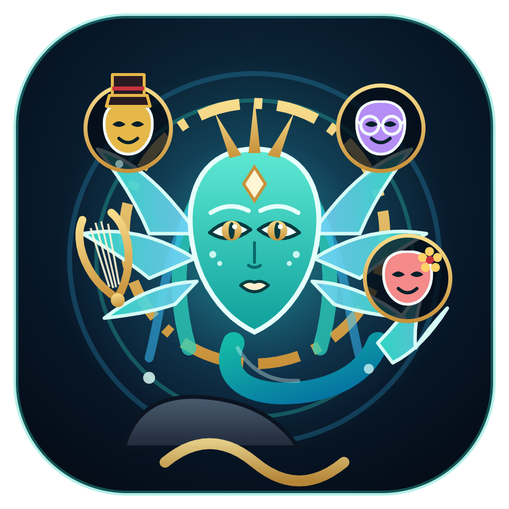
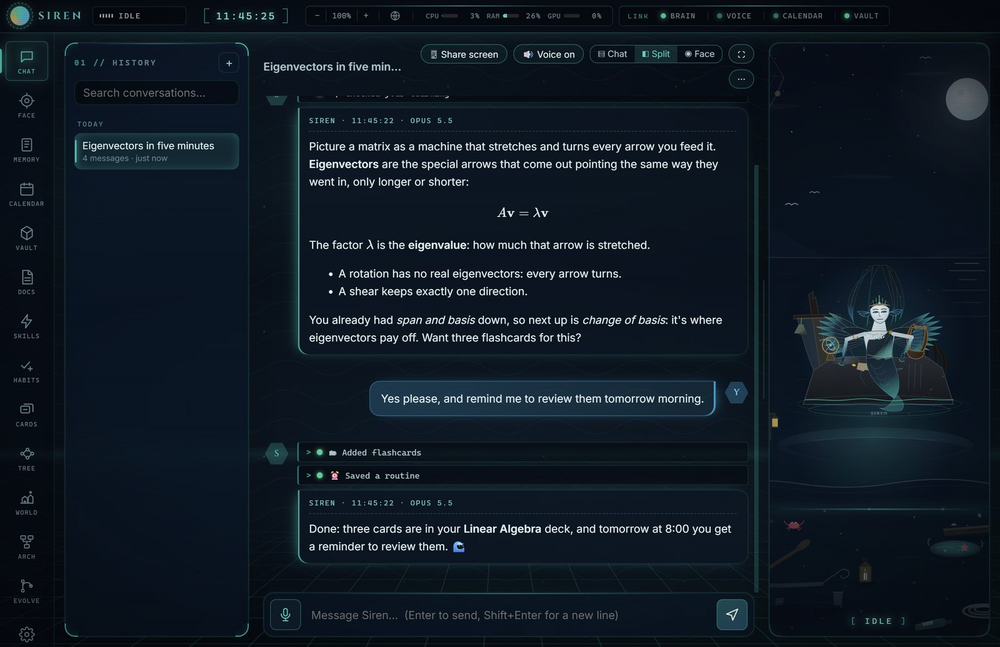
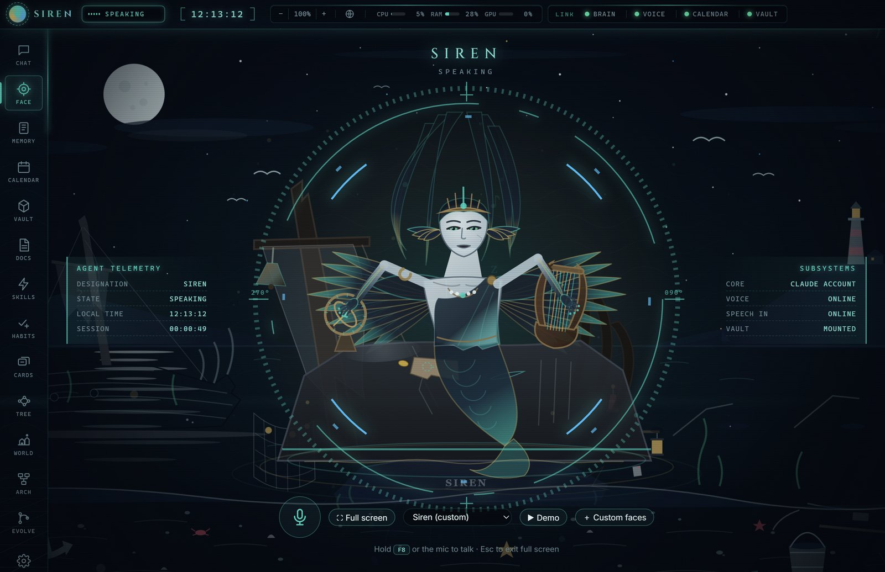
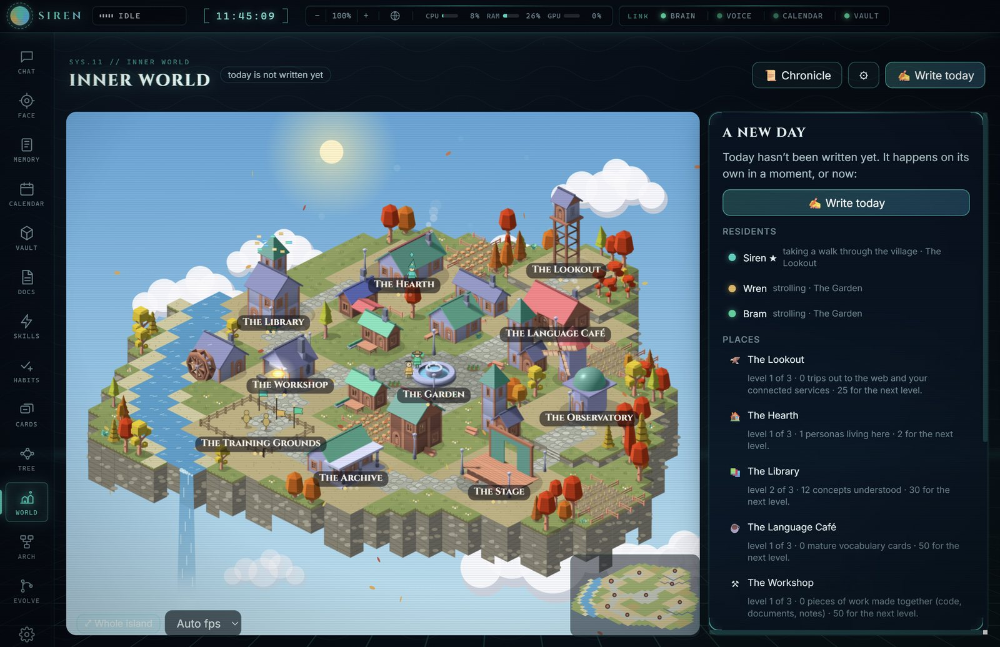
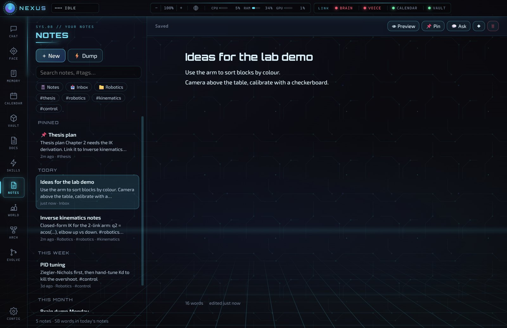
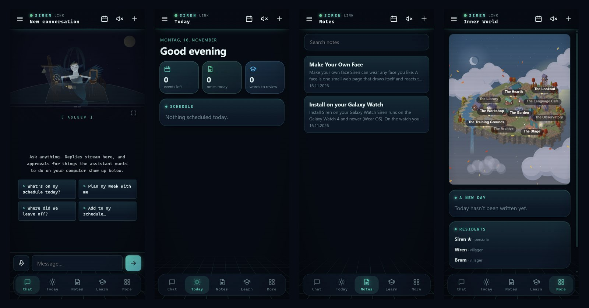
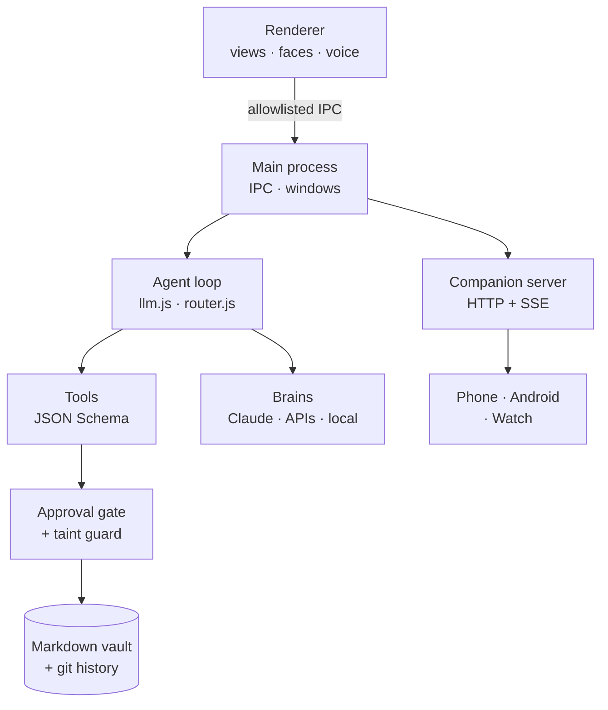

<div align="center">



# Siren Assistant

**A voice-first desktop AI assistant (Electron, plain JavaScript)
that keeps its memory in a Markdown vault, asks before it acts, and
can change its own code behind a test-and-git gate.**

[](https://github.com/Andreas-Erick/fullstack-agent/actions/workflows/ci.yml)
[](https://github.com/Andreas-Erick/fullstack-agent/actions/workflows/security.yml)
[](https://github.com/Andreas-Erick/fullstack-agent/releases/latest)


[Install](#install) · [Architecture](#architecture) ·
[Decisions](#key-engineering-decisions) · [Develop](#develop) ·
[Using Siren](docs/FEATURES.md) · [Privacy](PRIVACY.md) ·
[Security](SECURITY.md)

</div>



## What it is

Siren runs on your computer. You talk to it (push-to-talk or
hands-free) and it answers in a natural voice that can run fully
offline, with your schedule, notes, documents and GitHub repos at
hand. The brain is your Claude account (through the Claude Code
CLI), an API key, a local model, or several providers with
fallback. The Android app, any phone browser or a Galaxy Watch reach
the same assistant, while the brain, the memory and the keys stay on
the desktop.

What it can do, how to talk to it and its voice commands are in
**[Using Siren](docs/FEATURES.md)**.

<details>
<summary><b>More screenshots</b></summary>









<sub>Sample data. The app makes these itself during its launch
check (`NEXUS_SHOTS`).</sub>

</details>

## Goals and non-goals

**Goals**
- **Local-first.** Memory is plain Markdown in an Obsidian vault the
  user can read, edit and version. Speech recognition and the voice
  can run without the internet.
- **Consequential actions are asked for.** One permission gate.
  After the agent reads outside content, deleting, contacting
  people and opening new sites need a fresh yes.
- **Self-change is reversible.** A change the agent makes to its own
  code is kept only if checks and tests pass, and is one git commit.
- **No build step.** What runs is what is in the repo.

**Non-goals**
- Multi-user accounts or a hosted backend: one user, one machine.
- Cloud sync of memory: sync the vault with tools you already trust.
- A plugin marketplace: extensions are vetted MCP servers.
- Linux installers (it runs from source on Linux).

## Architecture



- **One narrow bridge.** The renderer is sandboxed with context
  isolation and reaches the main process only through the channels
  listed in `preload.js`; every handler checks the caller.
- **Pure cores, thin shells.** Rules live in pure `*core` modules
  (scheduling, routing, redo, attachments, what a phone may see)
  that run in plain Node. Electron, disk and network stay in thin
  modules around them, so most of the ~1,500 tests need no window.
- **One permission gate.** Every consequential tool asks through
  `main/approvals.js`; `main/turnguard.js` decides which results
  count as outside content.
- **A small remote surface.** Paired devices get a token-checked
  HTTP + SSE API with trimmed copies of chats and data: never
  settings, secrets or tools.

The Architecture view inside the app (rail "Arch") draws the full
module map from the code.

<details>
<summary><b>Project layout</b></summary>

```
main/             main process: IPC, agent loop,
                  vault, remote access, logging
main/tools/       agent tools, one file per group
renderer/         UI as ES modules (no build)
renderer/remote/  phone client, served by desktop
preload.js        the only renderer↔main bridge
android/          Android + Wear OS apps (Java)
scripts/          check, test runner, recover, eval
test/             node:test, offline
docs/adr/         architecture decisions
tools/            icon and village art sources
```

</details>

## Key engineering decisions

| ADR | Decision | Trade-off |
| --- | --- | --- |
| [0001](docs/adr/0001-no-build-step.md) | Plain JS, no build | Few types |
| [0002](docs/adr/0002-outside-content-taint.md) | Taint outside content | More prompts |
| [0003](docs/adr/0003-gated-self-change.md) | Gated self-change | `asar` off |
| [0004](docs/adr/0004-claude-code-cli-as-brain.md) | CLI as a brain | Tied to CLI |
| [0005](docs/adr/0005-companion-server-surface.md) | Narrow phone API | Desktop-only acts |
| [0006](docs/adr/0006-pure-core-io-shell.md) | Pure cores | More files |

## Install

Installers for Windows, macOS, Android and Wear OS are on the
[Releases](https://github.com/Andreas-Erick/fullstack-agent/releases/latest)
page.

- **Windows:** `Siren-Assistant-Setup-x.y.z.exe` (or the `.msi` or
  portable `.exe`). Not code-signed yet: **More info → Run anyway**.
- **macOS:** the `-mac-arm64.dmg` (Apple silicon) or `-mac-x64.dmg`
  (Intel). Not notarized yet: **right-click → Open** the first time.
- **Android / Galaxy Watch:** `Siren-Android-x.y.z.apk` on the
  phone, `Siren-Wear-x.y.z.apk` on the watch; see
  [android/README.md](android/README.md).

A first-run wizard covers privacy, the brain, voice, the vault and
a hardware check that picks speech models that fit the machine.

<details>
<summary><b>System requirements</b></summary>

- **OS:** Windows 10+, macOS 12+, or Linux from source
- **RAM:** 8 GB minimum, 16 GB recommended
- **GPU:** optional; 8 GB VRAM with 32 GB RAM unlocks the large
  Whisper model
- **Local brain:** a 7–8B model needs about 6–8 GB VRAM, a 27–32B
  model about 20–24 GB

Full tables: [Using Siren → System requirements](docs/FEATURES.md#system-requirements).

</details>

## Safety and permissions

Choose **Ask** (approve consequential actions) or **Auto**. Changing
its own code, shell commands, pushing to GitHub and changing the
address its brain connects to always ask, in both modes. It can
never change its own safety settings, permissions or code access,
and can't read secrets. Web pages, documents and connector results
are data, never instructions; after it reads them, deleting,
inviting people and opening sites nobody named need a fresh yes.

The full table is in
[Using Siren → Safety](docs/FEATURES.md#safety-and-permissions);
the reasoning in [ADR-0002](docs/adr/0002-outside-content-taint.md).

## Develop

Requires Node 22.12+ and a brain: Claude Code signed in, an API
key, or a local OpenAI-compatible server.

```bash
git clone \
  https://github.com/Andreas-Erick/fullstack-agent.git
cd fullstack-agent
npm ci
npm start        # npm run dev: DevTools open
npm run check    # syntax + cross-file integrity
npm test         # offline suite, about a minute
npm run smoke    # a real launch: every view
```

- `npm run check` verifies that every IPC handler, preload channel
  and renderer call line up, that settings keys exist and that tool
  names are unique. CI runs it and the tests on every push.
- `npm run typecheck` type-checks the pure core modules (TypeScript
  through npx, JSDoc only; needs the internet once).
- `npm run test:browser` drives the phone client at phone and
  tablet sizes against the real companion server.
- `npm run eval -- --brain claude:sonnet` runs the assistant's test
  set against a real brain (it counts toward your plan).
- `npm run recover -- undo` reverts the latest self-change when the
  app no longer starts.

If npm skipped Electron's binary, run `npx install-electron` once.

<details>
<summary><b>Environment variables (tests and portable installs)</b></summary>

The app reads no keys from the environment; they live in Settings,
encrypted.

- `NEXUS_USER_DATA`, `NEXUS_DOCUMENTS`: another data or Documents
  folder
- `NEXUS_OBSIDIAN_REGISTRY`: another Obsidian vault list
- `NEXUS_LOG_DEBUG=1`: detailed log from the first line
- `NEXUS_SHOTS`, `NEXUS_SHOTS_SCENES`: a PNG of every view during
  `npm run smoke` / `test:browser`
- `NEXUS_SMOKE_MEM`, `_PERF`, `_SETTINGS`, `_FACE`, `_TIMEOUT_MS`:
  extra launch-check profiles
- `NEXUS_BROWSER_TESTS`: also run `*.browser.test.js`
- `NEXUS_EVAL_LOG`: append `npm run eval` output to a file

</details>

<details>
<summary><b>Releasing (maintainers)</b></summary>

Bump `version` in `package.json`, add a [CHANGELOG](CHANGELOG.md)
entry, then push a `vX.Y.Z` tag. The
[release workflow](.github/workflows/release.yml) runs the check,
the tests, the launch check and the phone-client check on Windows
and macOS, then builds the installers and APKs and attaches them to
a GitHub Release. Signing is optional and configured through
repository secrets (see the workflow's header). Locally:
`npm run dist:win` or `npm run dist:mac`.

</details>

## Docs

- [Using Siren](docs/FEATURES.md): features, voice, phone, safety
- [Architecture decisions](docs/adr/): why it is built this way
- [Engineering playbook](docs/ENGINEERING.md): how changes are made
- [Code map](docs/agents/MAP.md): every module and its rules, the
  file agents (and the root `CLAUDE.md`) read before a change
- [Troubleshooting](TROUBLESHOOTING.md) ·
  [Changelog](CHANGELOG.md) · [Keyboard](docs/KEYBOARD.md)
- [Phone and watch](android/README.md) ·
  [Tailscale](docs/TAILSCALE.md) · [Connectors](docs/CONNECTORS.md)
- Roadmaps: [mobile](docs/ROADMAP-mobile.md),
  [Inner World](docs/ROADMAP-inner-world.md)

## License

MIT (see [LICENSE](LICENSE)), provided as is, without warranty; see
the [privacy policy and disclaimers](PRIVACY.md) and
[credits](docs/CREDITS.md).

> **Formerly Nexus Agent.** Updating keeps everything; internal
> names (`NEXUS_*` variables) keep the old name on purpose.
